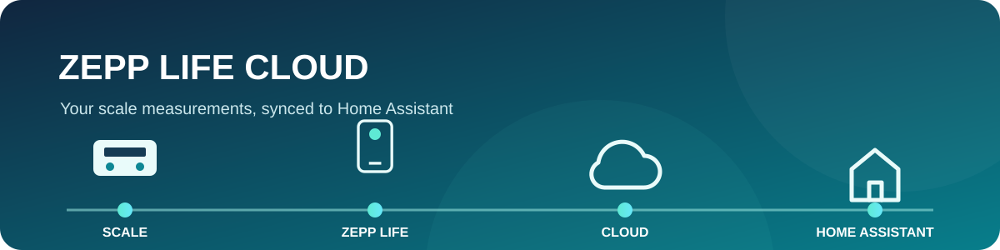

<h1>Zepp Life Cloud</h1>

<strong>Bring Zepp Life scale measurements into Home Assistant automatically.</strong>

Browser sign-in · Cloud polling · No Bluetooth receiver required

## ✨ Get started

| 1 · Add repo | 2 · Install | 3 · Restart | 4 · Add integration |
|:--|:--|:--|:--|
| HACS → Integrations → ⋮ → **Custom repositories** | Add this URL as type **Integration** | Download **Zepp Life Cloud**, then restart HA | Settings → Devices & services → **Add integration** → Zepp Life Cloud |

<strong>Repository URL</strong> <code>https://github.com/georgehanna1993/ha-zepp-life-cloud</code>

> 📱 **Before setup:** your scale must be paired with Zepp Life and the app must have synced at least one measurement. If it is already paired and synced, you do not need to pair it again or be at home.

## 🔐 Sign in — browser only

1. In the Home Assistant form, copy the **Xiaomi sign-in URL** and open it in a browser tab.
2. Sign in on Xiaomi’s website with the Xiaomi account linked to Zepp Life. Complete any verification Xiaomi requests. Your password is entered on Xiaomi’s site, not in Home Assistant.
3. After sign-in, the browser redirects to a Zepp callback address. The page may say **routes not found**; that is okay. Use the address bar.

<pre><code>https://api-mifit-cn.huami.com/huami.health.loginview.do?code=ALSG_CLOUDSRV_ABC123&amp;...</code></pre>

Copy **only the value after code= and before the next &amp;**. In the example above, the code to copy is:

<code><strong>ALSG_CLOUDSRV_ABC123</strong></code>

4. Paste that code into **Code from the callback URL** in Home Assistant. Leave **Member ID** as **-1** for the main profile, then submit promptly—the code expires. **Never share the code in chat.**
5. After setup, the integration checks the cloud every 60 minutes by default. Use **Sync now** for an immediate refresh.

## 📊 What you’ll get

- Separate sensors for weight, BMI, fat, water, muscle, bone, protein, visceral fat, BMR, body age, body score, impedance and other values the cloud returns.
- Metric-specific icons and grouped sensor names.
- Only actual Zepp Life cloud values; no locally calculated body composition.
- A measurement-time sensor, sync status, configurable polling and a **Sync now** button.

Compatibility and availability

Live sign-in and a cloud fetch appear to work in one Home Assistant setup. Compatibility has only been tried with the scale used for that setup; its exact model was not recorded. Other scale models and their available metrics are unverified—feel free to try it and report what works.

Measurements must first be uploaded by the Zepp Life phone app. Home Assistant reads cloud data; it does not need a Bluetooth connection to the scale.

Privacy, troubleshooting and tests

- The integration reads measurements from Zepp Life cloud and does not modify them.
- The Zepp app token is stored in the Home Assistant config entry; protect your HA backups.
- Xiaomi may require a fresh browser sign-in if authorization expires.
- The callback code is short-lived. Copy the value after code= and submit it promptly.

Run the offline checks from the repository folder:

<pre><code>python -m unittest discover -s tests -v
python -m compileall -q custom_components</code></pre>

Tests use simulated cloud responses; they do not verify every scale model or replace a full Home Assistant runtime test.

Technical notes and attribution

This unofficial integration uses the Zepp Life cloud API. The service may change without notice. Endpoint and field mapping are based on AlexxIT’s MIT-licensed [SmartScaleConnect](https://github.com/AlexxIT/SmartScaleConnect/tree/v0.4.2); attribution is in [THIRD_PARTY_LICENSES.txt](THIRD_PARTY_LICENSES.txt).

Made for the simple path: <strong>scale → Zepp Life → cloud → Home Assistant</strong>

